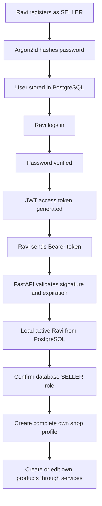

# Authentication and authorization — Phase 5

The frontend remains a separate demo. This phase changes only backend behavior.
No migration is needed: the existing User already has `password_hash`, `role`,
and `is_active`. No startup migrations or database creation occur.

## Who are you, and what may you do?

**Authentication** establishes who made a request. Registration creates an account;
login proves knowledge of its password. **Authorization** then checks whether that
account may perform the requested operation. A successful login does not grant
seller or administrator privileges.

**Role-based access control** checks BUYER, SELLER, or ADMIN from PostgreSQL.
**Ownership authorization** also checks the resource owner: even two SELLER users
have different permissions over their products. Actor IDs never come from client
headers, bodies, or query strings. Changing a path ID cannot change ownership.

## Passwords and hashing

Registration accepts name (1..120), email (valid, at most 320), phone (trimmed,
1..32), password (8..128), and optional role (defaults to BUYER). Only BUYER and
SELLER are allowed publicly; ADMIN and additional privileged fields yield 422.
Email is lowercased; phone is trimmed without guessing a country format. Provide
a consistent full phone number. Email/phone duplicates return a generic 409.

Passwords are preserved exactly, including spaces. The application passes the
plaintext directly to argon2-cffi's Argon2id PasswordHasher and stores only its
encoded result. The RFC 9106 low-memory profile uses 64 MiB memory, three passes,
four lanes, and a fresh random salt. A **hash** is a one-way verification value,
not reversible encryption. Different salts make identical passwords produce
different hashes. Plaintext storage would reveal every password after a database
leak; hashing makes guesses expensive. Never log request bodies or Authorization
headers in application/proxy tooling. Hashes are absent from all API responses.

Login verifies the supplied password against the stored hash. Existing bcrypt
hashes accepted by Phase 4 internal services are supported and replaced by Argon2id
after successful verification; bcrypt inputs over 72 UTF-8 bytes are rejected to
avoid truncation collisions. Older Argon2 settings are upgraded as needed. Invalid
stored hashes fail authentication. Login rejects wrong passwords, unknown accounts,
and inactive accounts with the same generic 401. Unknown/inactive accounts undergo
dummy hashing verification to reduce obvious account-existence timing differences;
this does not promise perfectly identical timing. Existing case-variant email rows
can be found, but ambiguous matches fail closed. No legacy rows are modified merely
to normalize identity. New public emails are normalized before database uniqueness
checks; the original database uniqueness constraints remain unchanged.

SELLER registration creates only a User. It creates no partial shop profile.
`POST /api/v1/sellers/me` subsequently requires shop name, phone, latitude and
longitude (and optional description). Coordinates are stored/validated only;
their presence does not mean distance calculations exist. Users cannot set their
owner ID or verification flag. ADMIN creation remains a trusted internal operator
operation, outside public HTTP; never promote a user through registration.

## JWT access tokens

A **JWT** is a compact signed token. An **access token** is the short-lived credential
returned by login. Send it as `Authorization: Bearer <access_token>`.
**Bearer** means anyone possessing the token can use it, so keep it private and
use HTTPS when serving this backend to real clients. A JWT is signed, not encrypted;
its contents can be read by whoever has it. This token contains only:

| Claim | Meaning |
|---|---|
| `sub` | User ID as a positive BIGINT decimal string |
| `iat` | Issued-at UTC Unix time |
| `exp` | Expiration UTC Unix time |

There is no email, phone, password, hash or role in issued tokens. HS256 signs tokens
with a configured **secret key**, which proves the token came from this backend.
The decoder accepts only the configured HS256 algorithm, requires all three claims,
validates signature/time/subject bounds, and rejects malformed tokens. Token headers
cannot select a different algorithm. Expiration is required; default lifetime is
15 minutes. After expiry, log in again. No refresh-token infrastructure is included.

Every authenticated request decodes the token and loads the current User from
PostgreSQL. Missing/deleted/inactive users lose access, even with an unexpired JWT.
Changing the database role takes effect on subsequent requests. Any role supplied
inside a signed token is ignored; the database remains authoritative. There is no
individual token blacklist or logout endpoint: active-account tokens remain valid
until expiration unless the account is disabled or the signing key is rotated.

## Configuration

Use these settings in environment variables or ignored `backend/.env`:

| Setting | Purpose |
|---|---|
| `DATABASE_URL` | Dedicated PostgreSQL application database using postgresql+psycopg |
| `WHAT_NOT_JWT_SECRET_KEY` | Required for auth; at least 32 bytes of securely generated random material |
| `WHAT_NOT_JWT_ALGORITHM` | HS256 only; defaults to HS256 |
| `WHAT_NOT_ACCESS_TOKEN_EXPIRE_MINUTES` | Integer 1..60; defaults to 15 |
| `WHAT_NOT_ENVIRONMENT` | development, test, or production |

Generate a private key locally with Python's `secrets.token_urlsafe(48)` and put it
only in the environment/ignored file; never put it in Git, a JWT, a response or logs.
Length validation cannot prove entropy. All backend instances serving the same
tokens need the same key. Rotating it invalidates existing tokens. Production
settings reject a missing key. Development health/docs still work without database
or key configuration; auth fails closed with 503 when required configuration is
absent. The example environment file contains comments/placeholders only.

Tests use an explicit test-only key and the existing newly generated local
PostgreSQL cluster. They do not consume a running application database. Neither
`whatnot_db` nor `upsc_compass` is accessed, inspected or migrated.

## Dependencies and transactions

`get_access_subject` reads the Bearer credential and validates the JWT before
database access. `get_current_user` loads the active current User.
`require_active_user`, `require_role`, `require_buyer`, `require_seller` and
`require_admin` express separate authentication and authorization checks.

`get_transaction_session` opens one explicit transaction before the authentication
query. All dependencies/routes/services share that request session. Services retain
their savepoints and row locks; authenticated IDs are passed to existing ownership
checks. Function-scoped transaction teardown commits before response delivery;
failures roll back. Responses are mapped while the session is open. This avoids
implicit SQLAlchemy transactions interfering with Phase 4 write requirements.

## Active routes

All paths below are under `/api/v1`. Bodies reject unknown fields.

| Route | Access |
|---|---|
| POST /auth/register | Public BUYER/SELLER account registration |
| POST /auth/login | Public credential verification |
| GET /auth/me | Active authenticated user |
| POST /sellers/me; GET/PATCH /sellers/me | SELLER; complete own profile only |
| GET /sellers/me/products | SELLER; own products, including pending/rejected |
| POST /products | SELLER; derive seller profile from authenticated user |
| PATCH /products/{id}; PATCH /products/{id}/activation; POST /products/{id}/resubmit | SELLER; owned products only |
| GET/POST /addresses; GET/PATCH /addresses/{id}; POST /addresses/{id}/default | Active user; own addresses only |
| GET /orders; GET /orders/{id}; PATCH /orders/{id}/status | BUYER/SELLER; owned orders only |
| GET /admin/products/pending; POST /admin/products/{id}/approve or /reject | Active database ADMIN only |

Order transitions retain Phase 4 rules: owning buyers may cancel eligible orders;
owning sellers advance supported states or cancel/reject eligible orders. ADMIN is
not an order owner. Address delivery fields referenced by an order remain immutable;
create a replacement address to preserve delivery history. No delete routes exist.

**Remaining 501:** GET /products, GET /products/{id}, and POST /orders. These are
buyer discovery/detail/checkout contracts; geography is not implemented. They do
no storage work and need no authentication. Authenticating them would not make
delivery-radius promises true. Invalid placeholder input still produces 422.

## HTTP behavior and safe output

| Status | Meaning |
|---|---|
| 401 | Missing, invalid, expired token; missing/inactive user; invalid login |
| 403 | Authenticated user lacks required role or ownership |
| 404 | Resource/profile not found |
| 409 | Duplicate identity/profile; invalid transition; stored-data/history conflict |
| 422 | Invalid input (after authentication for protected routes) |
| 500 | Stored data cannot be mapped safely into a response |
| 503 | Missing required configuration or unavailable database operation |
| 501 | Geographic workflow deliberately deferred |

401 includes `WWW-Authenticate: Bearer`. A valid token is not proof of permission:
that is why 403 differs from 401. Validation errors omit submitted input and exception
context. SQL errors and response-validation errors are generic; SQL, connection
credentials, signing keys and internal stack traces are never returned. Login/me
responses use `Cache-Control: no-store`. Public User output remains id/name/email/role.
Ownership 403 distinguishes an existing unrelated resource from a missing 404;
IDs are not secrets. Lists only return owned resources.

## Ravi's concrete flow

When Ravi edits `/products/124`, ProductService loads product 124 and its seller
profile. It compares the profile's user ID with Ravi's authenticated database ID.
If another seller owns it, the operation stops with 403 and changes nothing. A
different path, a forged role, or a body containing someone else's seller ID cannot
change that comparison.

## Limits and next phase

No frontend integration, geography, payments, infrastructure, social login, refresh
tokens, verification or recovery flows. Rate limiting/abuse controls and audit logging
remain future production hardening; logging must redact credentials. Lists of products,
pending products and orders retain the existing bounded first-100 service behavior;
addresses retain the existing service behavior. Existing legacy email collisions need
deliberate operator cleanup if present; no protected database was inspected to find
them. Recommended Phase 6: geographic eligibility with explicit API contracts and
isolated tests before activating buyer discovery/checkout, then separately planned
frontend integration.

Library references: [argon2-cffi parameters](https://argon2-cffi.readthedocs.io/en/stable/parameters.html)
and [PyJWT usage](https://pyjwt.readthedocs.io/en/latest/usage.html).
