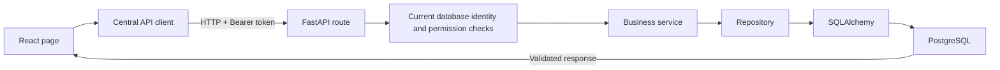

# React and FastAPI integration (Phase 6)

The account, seller, moderation, address and order-history screens now communicate
with the real backend. The public catalogue and buyer cart remain labelled sample
views. They never create real orders. Geographic discovery and checkout remain 501.

## Business verticals and the Phase 6 boundary

What Not? presents Homemade, Real Estate and Creative Services on the landing
page and buyer dashboard. `ExploreVerticals` contains presentation-only examples:
properties and creative services never enter the product reducer, basket, seller
form, order workflow or API payloads. Their controls are disabled and labelled
coming soon. No property/service endpoint or common production listing model was
introduced.

Homemade discovery uses the existing isolated sample catalogue, now including a
food example alongside candles, pottery and a handmade bag. The frontend-only
`Homemade Food` sample category does not extend `src/api/types.ts` or the backend
category enum. Real seller creation/editing keeps all existing API category values
and explains that food-specific tools/compliance, property listings and creative
requests are unavailable. Existing shop, product, moderation, address and owned
order APIs continue to work.

Food/product distinctions, compliance, stock/availability and delivery policies;
rent/sale, property types, bedrooms and property details; and service portfolios,
starting prices, turnaround times and request workflows need separate future
designs. The sample UI does not establish their final database/API models.

Product cards carry individual Sample badges. Sample seller contact is disabled;
invented shopper totals and live seller-verification claims were removed. Checkout
remains disabled. See [scope correction report](PHASE6_SCOPE_CORRECTION.md).

## What happens when you press a button?



React collects form fields and shows loading, success or error feedback. Files in
`src/api/` translate the action into an HTTP request. FastAPI identifies the user,
checks their role/ownership and calls the existing service. The service enforces
business rules; the repository performs database queries through SQLAlchemy.
PostgreSQL stores the change. React reloads the record/list from the backend.
Changing frontend buttons or roles cannot grant backend permission.

## Configure and run locally

From the repository root, copy `.env.example` to `.env.local` if needed:

```powershell
Copy-Item .env.example .env.local
```

The only browser setting is:

```dotenv
VITE_API_BASE_URL=http://127.0.0.1:8000/api/v1
```

Include `/api/v1`. The client strips a trailing slash. If unset, the centralized
client uses that development URL. Restart Vite after changing environment values.
Vite bundles `VITE_` values into public browser code: never put database credentials,
JWT signing keys, passwords or other secrets in frontend environment files.

Configure the backend separately following `backend/DATABASE.md` and
`backend/AUTHENTICATION.md`, using a dedicated development database. The application
never migrates automatically. This phase did not create/migrate any application
database. Do not use `whatnot_db` or `upsc_compass` for tests or this project's
migrations. Missing database/signing configuration produces a useful service error.

Start two terminals:

```powershell
# Repository root
npm run dev -- --host 127.0.0.1
```

```powershell
# backend directory
.\.venv\Scripts\python.exe -m uvicorn app.main:app --reload --host 127.0.0.1 --port 8000
```

Existing CORS permits only `http://localhost:5173` and `http://127.0.0.1:5173` by
default. Set `WHAT_NOT_CORS_ORIGINS` to an explicit JSON list if your development
origin differs. Production needs the exact HTTPS frontend origin and HTTPS API
URL. No wildcard origins or cookie credentials are introduced; requests use Bearer
headers and `credentials: omit`.

## Example 1: Ravi logs in

1. Ravi submits his email and password from the login form.
2. `authApi.login` calls `POST /auth/login` with JSON.
3. FastAPI verifies the exact password and active account through Phase 5 auth.
4. It returns a short-lived access token. React keeps it only in JavaScript memory.
5. React calls `GET /auth/me`; this identity determines the workspace, regardless
   of the role link Ravi chose on the login screen.
6. Subsequent protected requests carry `Authorization: Bearer <access_token>`.

The password stays temporarily in the form/submission and is cleared after every
attempt. It is never logged or persisted. Invalid, inactive or unknown accounts
receive the same generic failure by backend design. Registration accepts name,
email, phone, password and BUYER/SELLER only; ADMIN is never a public option.

## Session storage and logout

`AuthProvider` exposes the current user, role via `user.role`, loading/error state,
login and logout. `Boolean(user)` identifies an authenticated session; token
availability is accessed internally through `getAccessToken()` in the API client.
The UI never displays a token or infers permission from JWT claims.

There are no tokens in localStorage, sessionStorage, cookies, URLs or logs. This
reduces persistent credential exposure but does not prevent active-page XSS from
stealing a credential. A full reload or new tab requires signing in again. Provider
restoration within the same browser runtime calls `/auth/me` when an in-memory
credential exists; there is deliberately no cross-reload restoration.

Expiry triggers automatic session clearing. A protected 401 clears credentials,
identity and mounted user data. Logout does the same, resets the sample basket and
returns to the relevant public sign-in screen. Late responses from old sessions,
old page loaders or unmounted forms cannot revive credentials, overwrite another
order's screen or force navigation after cancellation. A public failed login does
not cause a client-wide protected-request invalidation.

There is no refresh token, cookie-auth redesign or server token-revocation endpoint.
An issued backend token can remain valid until expiry under Phase 5 rules. A safer
HttpOnly cookie strategy would require a separate backend/CSRF/CORS design; it is
not silently introduced in this phase.

## Example 2: Ravi creates a candle

Ravi registers as SELLER, logs in, and creates a complete seller profile (shop name,
phone, latitude, longitude, optional description). Registration alone does not
create a shop. Coordinates are stored settings, not distance calculations.

He submits a candle from Add product. React sends name, description, decimal price,
stock, category, configured delivery radius and optional HTTP(S) image URL to
`POST /products`. It sends no seller ID, moderation status or verification flag.
The Bearer token identifies Ravi; FastAPI confirms SELLER and derives his own shop.
The existing service creates the product as PENDING; PostgreSQL stores it. React
loads `/sellers/me/products` and shows the backend's Pending badge.

Approved edits return to PENDING. Rejected edits keep the reason until explicit
resubmission. Activation is independent of review. Product PATCH sends only changed
fields, so a metadata edit does not overwrite stock changed elsewhere. Clearing an
image sends `image_url: null`. An unchanged save sends no PATCH. Image uploads and
product deletion are unavailable because the backend does not support those routes.

## Example 3: An administrator approves the candle

The administrator signs in with an existing trusted ADMIN account. React loads
`GET /admin/products/pending`. Approve calls `POST /admin/products/{id}/approve`
without a fake admin ID. FastAPI checks the current database ADMIN role; the
moderation service permits PENDING -> APPROVED; PostgreSQL commits the change.
React reloads the queue. Rejection requires a nonblank reason and uses the separate
reject route. Approval does not imply geographic discovery is available.

The UI does not invent buyer counts, seller counts, earnings or commission settings.

## Addresses and orders

Addresses are listed/created/updated for the authenticated user. PATCH sends only
changed fields; unchanged delivery fields are omitted when editing a label. A
separate default operation switches the default atomically. Historical-order
address delivery fields are protected by the service. On a conflict, create a
replacement address; frontend controls cannot bypass that rule.

BUYER and SELLER order histories/details use their owned records only. Buyers see
cancellation for PLACED/ACCEPTED. Seller controls suggest the existing service map:
PLACED -> ACCEPTED/CANCELLED/REJECTED; ACCEPTED -> PREPARING/CANCELLED;
PREPARING -> OUT_FOR_DELIVERY; OUT_FOR_DELIVERY -> DELIVERED. Terminal states show no
actions. These are UX suggestions: every transition is still checked by FastAPI and
the service, and conflicts are displayed. Totals and order-item snapshots come from
the backend; React does not recalculate real financial totals.

## Transitional limits

- Sample catalogue names, distances, ratings, locations, verification and cart
  prices remain mock data. Every discovery/detail/cart view carries a notice.
- Real GET products/detail and POST orders remain 501. The UI never calls them.
- Checkout is disabled. The sample delivery fee is not a backend fee or payment.
- SELLER and ADMIN pages share no sample-product state with their backend records.
- Product, moderation and order lists expose the backend's first 100 records;
  pagination is not available. Seller edit looks up that owned list because buyer
  product detail is 501, so products beyond this limit need a future secure detail
  or pagination route.
- User profile editing, product uploads/deletion, payments and geographic eligibility
  remain future work. Buyer profile displays the authenticated identity read-only.

## Errors, identifiers and testing

The shared client adds JSON and Bearer headers, parses empty/JSON responses safely,
keeps BIGINT identifiers exact as decimal strings (including 9223372036854775807),
and preserves response decimal money strings. Writes use validated identifier paths;
no actor IDs are placed into protected write bodies.

401 clears sessions; 403 displays permission failure; 404 displays missing records;
409 displays conflicts/history guidance; 422 highlights allowed field names with
sanitized hints; network and server errors show friendly retry messages. Raw server
text, submitted validation inputs, SQL and traces are not rendered. React escapes
backend text. A saved mutation followed by failed refresh is reported as saved with
a refresh failure, avoiding an accidental duplicate submission.

Run frontend verification:

```powershell
node node_modules/vitest/vitest.mjs run --pool=vmThreads --maxWorkers=1
node node_modules/typescript/bin/tsc -b
npm run build
```

Backend verification uses the existing fresh temporary PostgreSQL harness only:

```powershell
# backend directory
$env:PATH = 'C:\Program Files\PostgreSQL\17\bin;' + $env:PATH
.\.venv\Scripts\python.exe -m pytest -q -W error
.\.venv\Scripts\python.exe -m compileall -q app alembic tests
.\.venv\Scripts\python.exe -m pip check
```

The optional live smoke check reuses that harness, creates a fresh UUID test
database, seeds only a temporary trusted ADMIN through the existing internal
service, and starts owned localhost API/preview servers. It verifies real
registration/login/profile/product/moderation/address flows and empty order
history. It checks seven screens at 1280, 768 and 390 pixels, primary-button
contrast >=4.5, no page overflow, no browser errors and no discovery/checkout calls.
External fonts/images are blocked in this offline smoke check. Credential-bearing
browser failure diagnostics are captured/discarded rather than written to logs.
No traces/videos/password fixtures are saved; screenshots use non-secret test data.

Use an already installed Playwright module/browser; no application dependency was
added. The production build must use the default development API origin for the
smoke runner's interception. Example with local tooling paths:

```powershell
$env:PATH = 'C:\Program Files\PostgreSQL\17\bin;' + $env:PATH
$env:WHATNOT_PLAYWRIGHT_MODULE = 'C:\path\to\installed\node_modules\@playwright\test'
$env:WHATNOT_BROWSER_EXECUTABLE = 'C:\path\to\browser.exe'
backend\.venv\Scripts\python.exe scripts/phase6_smoke.py
```

The backend test harness verifies its own generated data directory before using it
and confirms cluster shutdown before cleanup. No protected database fallback exists.
The smoke script overrides the database URL and all auth/CORS settings for its child
server; app.main's unused default app is lazy and opens no database connection.

See [PHASE6_REPORT.md](PHASE6_REPORT.md) and [validation screenshots](phase6/screenshots/).
