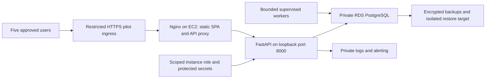

# What Not? production readiness audit — Step 25

**Production preparation addendum (15 November):** the findings and V1–V11 outputs below are the pre-change audit baseline. Subsequent authorized work fixed production frontend routing/build selection and backend production configuration/host/docs/header gaps, added Nginx/systemd candidates and a guarded admin bootstrap, and produced the [morning handoff](MORNING_DEPLOYMENT_HANDOFF.md) with current commands/results. Old statements that the current artifact contains loopback or that no deployment templates exist are superseded by that handoff. AWS, Linux runtime, TLS, recovery, privacy and pilot UAT gates remain unresolved: **NO-GO still applies**. Frontend timing failures were retained, not waived.

Audit date: 15 November 2026, Asia/Calcutta. Scope: restricted AWS pilot for **five selected users**. Decision: **NO-GO for deployment at this gate**. Local authentication recovery remains successful. No deployment, infrastructure creation, credential changes, commits or pushes were performed. The original database was accessed only through PostgreSQL-enforced read-only diagnostic connections; authentication endpoints and migration/worker commands were not run against it during this audit.

## 1. Executive summary

The application has meaningful authentication, role and ownership controls, transactional business rules, durable quotas and a migrated local schema. Fresh TypeScript/production build, all 254 frontend tests and 266 non-persistence backend tests pass. The reported intermittent frontend failure did not recur; its cause remains unresolved. These are useful release inputs, not evidence that AWS is configured securely.

The first blocker is the absence of a reviewed, enforceable production deployment/configuration profile: the fresh frontend bundle contains the HTTP loopback API fallback; backend production validation accepts incomplete or insecure transport settings; no Nginx, TLS, service supervision, IAM or network configuration is supplied. A five-account application allowlist does **not** make public listing endpoints private. Backups, restore objectives, alerting, scheduling, real mail and pilot privacy/acceptance evidence also remain incomplete.

No confirmed Critical exploit or tracked live-secret leak was established. High severity below includes missing evidence for controls whose failure could expose credentials, personal data or the database. Unknown infrastructure is marked NOT VERIFIED, not assumed insecure or passed. The existing working tree is not a reviewed release artifact.

## 2. Evidence and executed checks

Paths below are repository-relative. `file:line` identifies inspected source. Logs at the repository root are ignored diagnostic artifacts; retain them privately with this report. No dependency installation or upgrade was performed.

| ID | Check / exact command | Verified output and limits |
| --- | --- | --- |
| V1 | `git status --short`; `git rev-parse --short HEAD`; `git diff --check`; `rg --files --hidden` excluding `.git`, `node_modules`, `.venv`, `dist` and filtering deployment filenames | HEAD `5da76c8`; ten pre-existing tracked modifications and recovery/security files untracked. Diff check produced line-ending warnings, no whitespace error. No Dockerfile, Compose, Nginx, CI workflow or infrastructure definition found. No clean release snapshot established. |
| V2 | `& 'C:/Program Files/nodejs/npm.cmd' run build` | **Exit 0**, TypeScript and Vite 8.3.8 build, 1,938 modules, 7.02s; JS 426.13 kB / gzip 127.44 kB. `step25-build.log`. PowerShell rendered npm stderr notices as NativeCommandError records; process exit and completed build were verified. Static `Select-String -SimpleMatch 'http://127.0.0.1:8000/api/v1' -Quiet` against built JS returned **True**. This is a local-configured artifact, not a pilot artifact. |
| V3 | From `backend`: `& ./.venv/Scripts/python.exe -m pytest -q -W error tests --ignore=tests/persistence` | **Exit 0, 266 passed in 16.28s**; `step25-backend.log`. Non-persistence subset, not the complete backend suite or AWS integration. |
| V4 | `& 'C:/Program Files/nodejs/node.exe' node_modules/vitest/vitest.mjs run src/pages/AdminOperations.test.tsx src/location/geolocation.test.ts src/components/LocationPicker.test.tsx --pool=threads --maxWorkers=1 --no-file-parallelism` | **Exit 0, 27 passed, 3 files, 48.23s**; `step25-frontend-focused.log`. Mocked APIs, no PostgreSQL. Full rerun result is recorded in section 4. |
| V5 | `& backend/.venv/Scripts/python.exe docs/security/audit_runtime.py` | **Exit 0**; synthetic settings and unbound DB session. 86 routes inventoried; **77 protected routes returned 401** without a token. Missing/malformed/expired/forged tokens: 401. Configured CORS preflight 200; unconfigured 400 with no allow-origin. `/health`, `/docs`, `/redoc`, `/openapi.json`: 200; `/.env`, `/.git/config`: 404. Only `Cache-Control: no-store` among probed browser security headers. Missing production signing key rejected; production without DB, with HTTP CORS and with SMTP TLS disabled accepted. `step25-runtime-probes.log`. Authentication enforcement alone does not prove all object authorization paths. |
| V6 | `& backend/.venv/Scripts/python.exe docs/security/diagnose_auth_schema.py` | **Exit 0**, transaction_read_only=true; configured loopback target matches connection; revision **0008**, **24 tables**, **6 users**, **2 COMPLETED + 1 PLACED orders**, missing-table/column drift `{}`; current User and RequestQuota ORM projections PASS. `step25-database-readonly.log`. Inspection checks names/projections, not exhaustive index, constraint or production schema equivalence. No personal records printed. |
| V7 | `& backend/.venv/Scripts/python.exe docs/security/audit_secret_scan.py --artifacts` | **Exit 0**, redacted heuristic scan: 311 tracked files, 16 reachable commits, 645 history blobs, 550 workspace artifact files. Matches report path/line/rule only. Ignored `backend/.env` contains local configuration. Tracked candidates are example URLs, synthetic test credentials and form syntax; see prior `security/SECRET_SCAN_REPORT.md:23`. New recovery-script candidates are synthetic harness settings. No confirmed tracked live credential; **not exhaustive secret clearance**. `step25-secret-scan.log`. Gitleaks, pip-audit, Bandit, Semgrep, Trivy absent; Python pip_audit module also absent. |
| V8 | `& backend/.venv/Scripts/python.exe -m pip check`; `git check-ignore --no-index .env.production backend/.env.production` | pip: **No broken requirements found**. Neither production env filename is ignored (no match / exit 1); dependency consistency is not CVE scanning. |
| V9 | `Get-FileHash -Algorithm SHA256` and `pg_restore --list` for the cutover archive below | SHA-256 matches retained cutover evidence; **31,700 bytes**, archive listing **exit 0**, `step25-backup-list.log`. No restore or DB mutation performed by this check. Listing/hash does not prove restorability. |
| V10 | Read `OVERNIGHT_RECOVERY_REPORT.md`, final rehearsal/cutover reports, security reports, runbook, source and templates | Historical evidence explicitly distinguished below. `docs/security/audit_inventory.py` was also run; it regenerates the authorization matrix from **retained baseline** runtime evidence, not fresh cloud evidence. |
| V11 | `& 'C:/Program Files/nodejs/node.exe' node_modules/vitest/vitest.mjs run --pool=threads --maxWorkers=1 --no-file-parallelism` | **Exit 0, 254 passed / 254, 29 files, 321.22s**; `step25-frontend-full.log`. Unchanged test/application source. Current complete frontend suite is green; repeated passing runs do not establish the cause of a prior intermittent failure. |

Historical database-backed evidence: `security/evidence/auth-database-tests.json:2` records **182 passed, 0 failures/errors/skips, 93.886s**, verified isolated `whatnot_tests_20261115_a7e394c2` OID 49265, 2,034 guarded SQL statements, original rows unchanged. Not rerun here: its fixtures mutate the test DB. Historical local HTTP evidence `security/evidence/auth-local-http.json` / `OVERNIGHT_RECOVERY_REPORT.md:104` records health/readiness 200, registration 201, duplicate 409, login/me 200, wrong password 401 and bounded quota 429. This deliberately added a synthetic sixth user; the five original users were preserved. Do not misreport six as a migration-created extra account or export that synthetic account to production.

## 3. Findings by required audit area

Severity applies to the finding/risk; PASS rows use LOW as residual risk, not a claim of zero risk. FAIL means a confirmed gap. NOT VERIFIED means execution/configuration evidence is missing. NOT APPLICABLE is limited to the present implementation. Commands are V1–V10 above unless noted.

| ID / area | Status / severity | Existing implementation and evidence | Verified result / missing requirement / recommended correction |
| --- | --- | --- | --- |
| A1 Frontend build | PASS / LOW | `package.json:8`; `vite.config.ts:4`; TypeScript followed by Vite production bundling | V2 passes. No asset-size blocker identified for five users. Serve immutable versioned assets with a controlled HTML cache policy and verify real-host routing; build success proves neither TLS nor API connectivity. |
| A2 Frontend production API | FAIL / HIGH | `src/api/client.ts:42`; `.env.example:2` default to `http://127.0.0.1:8000/api/v1` | V2 confirms this string in the fresh artifact. Unless configured, a remote browser calls its own machine; HTTPS pages also face insecure-request policy. Require a reviewed HTTPS same-origin `/api/v1` build configuration and a production guard rejecting accidental loopback/HTTP. Rebuild and inspect the release artifact, then test real-host requests. |
| A3 Intermittent frontend test cause | NOT VERIFIED / MEDIUM | `src/pages/AdminOperations.test.tsx:21`; async loading `src/pages/AdminOperations.tsx:18`, `src/state/useResource.ts:7`, `src/state/AuthContext.tsx:18` | Historical full suite had one unresolved failure. Fresh V4 and **full V11 pass**; section 4 retains both failed and passing evidence. No confirmed fix or root cause. Maintain a stable full-suite gate and investigate recurrence without weakening reason/PATCH assertions. |
| B1 Authentication and role enforcement | PASS / LOW | Argon2id/legacy rehash `backend/app/core/security.py:16`, `backend/app/services/auth.py:26`; pinned HS256/required claims `core/security.py:52`; current active DB role/admission `api/dependencies.py:61`; role allowlist on registration `schemas/auth.py:14` | V3/V5 and retained isolated tests support these controls. Missing token and forged/expired token handling verified without DB writes. Continue cross-role/ownership staging tests; ADMIN cannot be self-selected via registration. |
| B2 Object/business authorization | PASS / LOW | `backend/app/services/orders.py:61`, `:95`, `:123`, `:223`; `services/properties.py:150`; `services/creative.py:147`; `api/routes/admin.py:46` | Source and historical isolated tests cover party scoping, server prices, stock/idempotency, private address restrictions and reasoned admin access. Not an exhaustive proof of all branches or a production E2E test. V5's 77 unauthorized probes establish only authentication. |
| B3 Fully restricted pilot and session lifecycle | FAIL / HIGH | Admission `services/abuse.py:45`; public property/Creative routes `api/routes/properties.py:13`, `creative.py:22`; in-memory token/logout `src/api/client.ts:5`, `src/state/AuthContext.tsx:44` | Public browse is outside the account allowlist; CORS does not prevent direct HTTP clients. Add a reviewed perimeter access gate covering the entire pilot and maintain exactly five admitted identities including the recovery/admin operator. Test nonparticipant denial. Copied JWTs persist until expiry (default 15 min); document that LOW residual or approve session revocation separately. No password-reset feature observed; define secure operator recovery without sharing credentials. |
| C1 Local migrated schema | PASS / LOW | `backend/alembic/versions/0008_beta_abuse.py:12`, `:18`; `0005_beta_foundation.py:57`; `backend/alembic/env.py:38` | V6 confirms head/projections/counts; historical cutover confirms exactly two COMPLETED/LEGACY transformations and two ORDER_MIGRATION audits. V6 did not recompare password hashes, audit contents or every constraint. Original database unchanged by this audit. |
| C2 Production DB and migration procedure | NOT VERIFIED / HIGH | `backend/app/db/session.py:10` lazy pool_pre_ping engine; `backend/alembic/env.py:18`, `:41`; `docs/BETA_RUNBOOK.md:38` maintenance/rehearsal sequence | No AWS target, CA verification, runtime grants, separate migration role, pool sizing/timeouts, server capacity or approved import plan evidenced. URL validation checks driver/name, not remote TLS. Pin revision 0008, identity-check target, stop writers and restarts, verify backup/restore, migrate once under approved maintenance, inspect schema/data before enabling traffic. Never blindly downgrade/stamp/reset. Existing local success authorizes no AWS migration. |
| D1 Secret handling | PASS / LOW | SecretStr/config error hiding `backend/app/core/config.py:15`, `:18`, `:77`; no SQL echo `db/session.py:14`; no-store/credential omission `src/api/client.ts:52` | V7 found no confirmed tracked live secret. Only a public API base belongs in VITE variables. The local ignored env credential is not proof of exposure; provenance/reuse remains unverified. Keep raw envs/backups/logs private and redact review artifacts. |
| D2 Production secret delivery / env prevention | NOT VERIFIED / HIGH | `backend/.env.example:1`; `backend/app/core/config.py:12`; `.gitignore:13` | No production secret delivery, file permissions, IAM scope, rotation/recovery evidence. V8 additionally confirms a LOW preventive gap: `.env.production` variants can be tracked. Use dedicated server secrets through a narrowly scoped instance role and protected runtime injection, never reuse local credentials; broaden ignore patterns with template exceptions and scan release artifacts. Changes to credentials require separate authorization. |
| D3 Fail-closed production settings | FAIL / MEDIUM | `backend/app/core/config.py:48`, `:72`, `:77`, `:96`; `services/mail.py:43` | V5 accepts production without DATABASE_URL, HTTP CORS and SMTP TLS disabled. Missing signing key/empty allowlist/disabled abuse are already rejected. Add tested production requirements for DB, HTTPS origins and encrypted verified remote DB transport; require TLS for enabled production SMTP. Preserve localhost development. Health can be 200 while storage is unusable; gate releases on readiness. |
| E1 Validation, CORS, safe errors | PASS / LOW | `schemas/common.py:16` extra fields forbidden; bounded IDs/money; `app/main.py:41` explicit CORS/credentials false; `api/errors.py:16`, `:49`, `:54`; `api/dependencies.py:34` transaction dependency | V3/V5 confirm configured/unconfigured CORS and generic token/error boundaries. SQLAlchemy failures return generic 503; handlers log exception classes, not SQL inputs. Raw unhandled tracebacks and proxy/access logs still require production review. CORS is not authorization. |
| E2 Headers / host / proxy trust | FAIL / MEDIUM | `backend/app/main.py:25`, `:35`; `api/routes/auth.py:15` quotas use request.client.host | V5 lacks HSTS, CSP, nosniff, frame and referrer controls and request ID. No trusted-host or trusted-proxy deployment policy supplied. Implement headers at the TLS proxy, safe static/API cache policy, body/time limits and explicit host validation. Trust forwarded IP only from the loopback proxy; prove spoofed headers cannot bypass quotas and multiple users do not exhaust a shared proxy bucket. Do not enable unrestricted forwarded-IP trust. |
| E3 Abuse coverage | FAIL / MEDIUM | `services/abuse.py:17`, `:34`; `api/routes/auth.py:12`; `services/properties.py:118`, `:128`, `:170`; `services/creative.py:131` | Durable auth/address/discovery/checkout limits exist; historical quota 429 verified. Public reads and several enquiry/visit/report/RFQ writes lack equivalent action budgets. Select pilot budgets, add perimeter bounds and test bounded denial/recovery with test DB. Hashed scopes are pseudonymous; no quota retention cleanup scheduler exists (`docs/BETA_RUNBOOK.md:100`). |
| E4 API metadata | FAIL / LOW | FastAPI default docs `backend/app/main.py:25`; public readiness `api/routes/health.py:18` | V5 docs/OpenAPI publicly available in synthetic production settings. Readiness exposes schema/backlog aggregates, not recipients. Restrict docs/readiness to the pilot/operator perimeter; keep minimal liveness available only as needed for monitoring. |
| F Docker/container security | NOT APPLICABLE / LOW | V1 repository inventory: no Dockerfile/Compose/container workflow; current runbook uses Python CLI and built SPA | Installing Docker locally does not mean the app is containerized. Proposed pilot uses a supervised host service. Do not require or introduce Docker for this audit. If containers are later selected, reassess non-root user, immutable pinned images, image CVEs, read-only filesystem, dropped capabilities and secret delivery before release. |
| G AWS IAM/network/host | NOT VERIFIED / HIGH | No project IAM, SG, VPC, host/service or infrastructure definitions in V1; `docs/security/DEPLOYMENT_SECURITY_CHECKLIST.md:14` still pending | No AWS account/resource inspection was performed. Need reviewed actual IAM/SG/routes, private DB, no public 5432/8000, least privilege, MFA, IMDSv2, OS patch/support baseline, non-root service, disk encryption, administrator access and budget owner. Section 6 is a proposal, not deployed evidence. |
| H HTTPS/domain/Nginx | NOT VERIFIED / HIGH | No proxy/certificate/domain config in V1; frontend HTTP fallback `src/api/client.ts:42`; secure-context geolocation `src/location/geolocation.ts:22` | No certificate, renewal, HTTPS redirect, proxy isolation, host routing or remote geolocation proof. Create and validate configuration before deployment approval; later verify from outside AWS that only approved pilot ingress is reachable. HTTPS/localhost browser geolocation tests are separate acceptance gates. No Google Maps/geocoding integration is needed. |
| I Backup/restore/rollback | NOT VERIFIED / HIGH | `docs/OVERNIGHT_RECOVERY_REPORT.md:50`, `:72`; `docs/AUTH_MIGRATION_FINAL_REHEARSAL.md:72`; downgrade guards `0008_beta_abuse.py:22` | V9 revalidates local archive/hash/list only; earlier rehearsal restored a different backup. Fresh cutover archive not restore-tested, stored in TEMP, and predates the sixth synthetic user. No durable AWS encrypted backup, retention/PITR, restore IAM, measured RPO/RTO or approved recovery target. Establish and restore-test the production backup strategy; recovery into a new isolated target, then deliberate cutover, never automatic destructive restoration/downgrade. |
| J Logging/monitoring/workers | NOT VERIFIED / HIGH | Sanitized errors `api/errors.py:49`; liveness/readiness `api/routes/health.py:12`; bounded commands `app/workers.py:10`; leases/retries `services/workers.py:27`, `:58`, `:103`; SMTP TLS branch `services/mail.py:43` | V5 health and V6 DB queries pass; historical local readiness passes. No installed scheduler, log shipping/retention, correlation, alarm delivery, missed-run monitoring or real SMTP delivery proof. Disabled mail leaves pending events. Configure bounded supervised scheduled jobs, alert on failures/backlog age/missed runs/5xx/DB/storage/backup/cert issues; test alerts and provider delivery without real-user payloads. Readiness is not email/scheduler liveness. |
| K Pilot E2E workflows | NOT VERIFIED / HIGH | `scripts/beta_browser_smoke.mjs:84`, `:129`, `:144`; `docs/BETA_RUNBOOK.md:53`; supported discovery routes `api/routes/discovery.py:12` versus legacy 501 `api/routes/products.py:12` | Historical browser/API checks exist, but no current deployed five-user buyer/seller/admin UAT, cross-account checks, browser/OS geolocation and mail/worker flow. Legacy public GET product endpoints deliberately return 501; supported UI discovery uses POST. Do not call whole API complete or remove placeholder routes without scope review. Execute section 8 with synthetic data before participant admission. |
| L1 Location and data minimization | PASS / LOW | `src/location/geolocation.ts:22`, `:35`; `src/components/LocationPicker.tsx:14`; `src/pages/DiscoveryPages.tsx:19`; `backend/app/services/discovery.py:13`, `:40`; `services/properties.py:150` | User-action geolocation with bounded timeout/errors, transient discovery coordinates, coarse seller discovery and private appointment gates inspected. V4 covers permission/success/error/manual-coordinate fallback helpers/components; V11 also covers PIN saved-address fallback integration (`src/LocationDiscovery.test.tsx:96`). PIN entry filters existing owned saved addresses; it does not geocode an arbitrary PIN. Discovery is deliberately a locality candidate list (cell centre plus 0.8 km margin), not exact seller-distance proof; checkout confirms exact eligibility. No precise seller coordinate in BuyerProduct projection. Saved delivery addresses intentionally persist: do not claim all location is transient. No live coordinate logging test at a deployed proxy. |
| K2 Radius-filter scope | FAIL / MEDIUM | Sample filter `src/pages/BuyerPages.tsx:21`, `:31`; selector `src/components/Shared.tsx:22`; live query `src/pages/DiscoveryPages.tsx:30`; seller radius schema `backend/app/schemas/product.py:10` | Existing 1/2/3 km **sample** selector and seller delivery-radius choices remain. The live buyer discovery view has no equivalent buyer radius selector; it queries locality candidates using seller radii. Do not claim the sample filter validates live distance filtering. Confirm whether live selectable buyer radius is required for the five-user scope; implement/test with an approved privacy-preserving contract if required, or explicitly disclose/approve locality-based discovery. No functional change made in this audit. |
| L2 Pilot PII governance/shared device | FAIL / HIGH | `src/config/business.ts:5`; `src/pages/LegalPages.tsx:16`, `:54`; drafts `src/state/creativeRecovery.ts:9`, `:21`, `src/state/checkoutRecovery.ts:40`; logout `src/state/AuthContext.tsx:44` | Legal/operator/privacy contacts remain empty/unconfirmed; retention, erasure/support, processor/region and backup handling not operationally approved. Private tab drafts can survive logout; external image hosts receive network information. Approve a proportionate five-user notice, operator contact/incident procedure, explicit retention/access/deletion and shared-device policy before collecting real PII. Do not copy local customer records to AWS by default. Cleanup must preserve idempotent uncertain-write recovery; decide then test it. This is a technical finding, not a legal compliance opinion. |

## 4. Frontend intermittent failure investigation

Retained full-suite evidence: `OVERNIGHT_RECOVERY_REPORT.md:143` and `overnight-frontend-verified.log` show **253 passed, 1 failed / 254**, 29 files, 330.97s, exit 1. Failure: “requires an investigation reason and sends only authorized account action fields”, `src/pages/AdminOperations.test.tsx:21`, could not find `Suspend Buyer` within the asynchronous query deadline. An unchanged historical focused rerun passed 17/17. Earlier constrained/concurrent runs stalled or failed and were stopped; they are not passing suite evidence.

Source trace: the test mounts the whole App with a bearer token; AuthProvider first loads `/auth/me`; AdminOperations then waits on four parallel requests (`/admin/users`, `/admin/orders`, `/admin/audit`, `/admin/operations`) and `useResource` publishes the result. The button is conditional on resource loading finishing. The test uses `findByRole` without its own wait options; `vite.config.ts:6` and test setup do not configure an extended async query deadline. Worker startup/CPU scheduling and async rendering are plausible influences. There is **no proven causal trace** establishing timeout pressure versus lifecycle/inter-test interference. No application authorization failure has been demonstrated by this assertion failure.

Fresh focused V4: **27/27 passed** unchanged, including both admin tests. Fresh full-suite V11: **254/254 tests passed, 29/29 files, 321.22s, exit 0**, using `node node_modules/vitest/vitest.mjs run --pool=threads --maxWorkers=1 --no-file-parallelism`; see `step25-frontend-full.log`. Thus the latest complete suite is green, and the previous failure was not reproduced. No source fix was made or proven necessary. Do not combine focused/full runs as extra unique coverage. The residual investigation status remains NOT VERIFIED / MEDIUM.

Recommended investigation/fix: capture the failed DOM and request completion/order if recurrence occurs; verify all four mocked reads and auth hydration settle; isolate lingering global state across files; add an explicit, bounded wait for the loaded accounts region if timing is confirmed. Keep both no-reason denial and exact authorized PATCH assertions. Do not merely increase the whole suite timeout or skip the test. Require a complete clean run on the reviewed release and repeated affected-file runs; retain prior failures and document any accepted residual flakiness.

## 5. Dependency and secret security limits

The retained 14 November lock-graph audit `security/evidence/pnpm-final.json:1` has **0 High/Critical, 2 Moderate** advisories involving Vitest mocker 5.0.2. Vite 8.3.8, undici 8.12.2 and source-map-js 1.2.2 corrections are documented in the prior security audit. These are **historical advisory results**, not a fresh registry clearance. The fresh focused runner confirms Vitest 5.0.2 is still installed. Dev tooling must not run on the public host. Review/patch the reported tooling advisories and rerun an approved current lockfile advisory scan before release.

**Python CVE status: NOT VERIFIED / HIGH potential release risk.** Exact pins exist (`backend/requirements.txt:2`), but pip check only verifies dependency compatibility. No Python advisory scanner was installed or silently added. Run a reviewed scanner in an isolated tool environment against the exact runtime graph; triage results and retain a dated report. Additional SAST/secret scanners are useful follow-up, not scans claimed by this audit. `package.json:13` uses several `latest` ranges; release installs must use the reviewed pnpm lockfile with frozen resolution. No CI currently enforces it. Review all existing diffs, not only this audit documentation.

Fresh heuristic artifact scanning also flags `backend/phase5-collection.log:140`; this log candidate has not been independently cleared in this audit. Keep diagnostic artifacts private and review it through a redacting classifier before external sharing. Absence of a confirmed tracked live credential must not be generalized to all local logs or external copies.

## 6. Proposed AWS architecture — not implemented

For five users, review a single supervised EC2 application host plus private RDS PostgreSQL. A single host is a deliberate availability limitation, not high availability. Do not add containers/orchestration just to satisfy this audit. No resources, IAM policies or estimated spending have been approved or created by this document.



| Boundary | Proposed rule / required evidence |
| --- | --- |
| Pilot ingress | Five-account application allowlist **plus** VPN/private ingress or a reviewed whole-site access gate; choose based on participant devices/IP stability. Public approved listing reads must also be covered. Fixed-source SG allowlisting is viable only if every participant's source is stable and verified; do not invent addresses. |
| EC2 / Nginx | TLS 443 only from the chosen ingress; HTTP 80 only if required for approved redirect/certificate validation. Valid domain/certificate and automatic renewal. Serve SPA deep links; proxy `/api/v1` without changing its prefix to loopback API; set safe headers, body/time limits, trusted forwarded source and redacted access logging. No public 8000; no Vite dev/preview server. |
| Database | RDS non-public, private subnet group; inbound 5432 only from application SG; encrypted storage/backups; require SSL and client `sslmode=verify-full` with the correct CA/hostname. Dedicated limited runtime role, separately controlled migration role. Verify denied connections from unauthorized sources and denied DDL for runtime role. |
| Administration / secrets | Prefer managed private operator access (for example SSM) instead of public SSH. MFA and temporary operator credentials; EC2 role only for named secrets/log resources, no wildcard administrative permissions. IMDSv2 required. Secrets retrieved through protected runtime delivery; never in browser assets, Git, command history or user-data output. |
| Jobs / operation | Non-root supervised API plus bounded email/order/property schedules; controlled restarts must honor maintenance. Separate test target with identity guards. Private logs with defined retention, backup/PITR policies, restore exercise and actionable alerts. No automatic production migration on API startup. |

These recommendations follow [AWS IAM best practices](https://docs.aws.amazon.com/IAM/latest/UserGuide/best-practices.html), [Secrets Manager guidance](https://docs.aws.amazon.com/secretsmanager/latest/userguide/best-practices.html), [private RDS networking](https://docs.aws.amazon.com/AmazonRDS/latest/gettingstartedguide/security-public-private.html), [RDS PostgreSQL TLS verification](https://docs.aws.amazon.com/AmazonRDS/latest/UserGuide/PostgreSQL.Concepts.General.SSL.html), and [automated backup guidance](https://docs.aws.amazon.com/AmazonRDS/latest/UserGuide/USER_WorkingWithAutomatedBackups.html). They are a design proposal; actual policies, endpoints and recovery behavior need verification. Budget, region, account, domain and access method remain owner decisions.

## 7. Backup and recovery evidence

Revalidated archive:

```text
C:\Users\DELL\AppData\Local\Temp\WhatNotCutover-lmyzuezk\whatnot_app_dev-0004-cutover.dump
Bytes: 31700
SHA-256: 75cbb960eb64b61ebe9aba5f377efe7d4c96018b556502ad43ade30951a08025
pg_restore --list exit: 0
```

This is the protected pre-cutover snapshot, with five original users/three orders/revision 0004. The local database is now 0008 with six users after the authorized synthetic smoke test. Earlier archive rehearsal proved the reviewed migrations on an isolated copy; it is not a test restore of this archive. A single-database dump does not preserve cluster roles/tablespace provisioning. TEMP storage and ACL restriction do not establish durable encrypted off-host recovery. No production RPO/RTO is defined or measured. Set approved numeric objectives and retention, test restoration to a **new isolated target**, reconcile data and measure elapsed recovery/data loss before declaring recovery ready. Preserve business/audit records created after any backup; never automatically overwrite the original.

## 8. Required corrections and pilot acceptance

Priority order (all deployment blockers stay closed until evidence is reviewed):

1. **P0 / engineering + operator:** implement and review a fail-closed production profile and Nginx/service templates. Require the correct HTTPS API destination, DB configuration and verified transport; preserve development behavior. Specify the whole-site five-user gate and trusted proxy policy. Test invalid configurations, compiled artifact destination and proxy behavior. No AWS creation needed for this implementation step.
2. **P0 / operator + security:** review real AWS IAM/network/host/TLS/secret settings against section 6, approve budget and access design, then obtain separate deployment authorization. No exposed DB/API ports, broad runtime admin grants or credentials in assets.
3. **P0 / operator:** set numeric RPO/RTO and retention, establish encrypted durable backups/PITR and execute an isolated restore drill. Prepare maintenance, rollback/forward-repair and incident contact procedures. Prove alerts, schedules and TLS mail or explicitly approve/test an in-app-only pilot with adjusted user expectations and backlog handling.
4. **P0 / privacy/product owner:** confirm five identities/roles, controlled registration and recovery operator; approve data notice/contact, processor/region inventory, retention/access/deletion/shared-device handling. Use synthetic staging data and explicit approved minimal pilot import; do not copy local data by default.
5. **P1 / engineering + security:** investigate the frontend failure, review existing dirty-tree changes, obtain a complete green release suite, current JS/Python advisory triage, extend abuse bounds and address metadata/header/env-file gaps. Any deferred Medium/Low risk requires named owner, mitigation and expiry; a passing subset cannot waive a High blocker.
6. **P1 / pilot owner:** execute witnessed UAT on the approved HTTPS environment, including the checks below, before admitting real users. Record role, result and redacted evidence per scenario.

Required UAT: buyer registration/login/session expiry/logout, denied nonparticipant, seller profile and dispatch location, product creation and admin moderation, buyer geolocation allow/deny/timeout/unavailable and PIN saved-address/manual-coordinate fallback, the approved radius/locality behavior from K2 and exact checkout boundary, stock/price-change consent and idempotent retry, cross-buyer/seller denial, order preparation/delivery/confirmation/dispute and bounded auto-completion, lifecycle-controlled fulfillment privacy, notifications and mail/retry/dead-letter handling. If property/Creative features remain enabled, also test sale moderation/expiry/enquiry/confirmed-visit address privacy and provider moderation/quote acceptance/delivery/buyer completion/review with cross-account denial. Features lacking this evidence must be explicitly excluded through a reviewed scope/access change before pilot use, not merely omitted from UAT.

Accept only when the [ordered checklist](AWS_PILOT_DEPLOYMENT_CHECKLIST.md) has evidence for every required gate, no unresolved Critical/High blockers, current full regression/build/security review for the exact release, measured restore/alert proof, completed privacy/contact setup and explicit release-owner sign-off. **CONDITIONAL GO is not granted** by this report; it cannot substitute for missing transport, access, recovery or PII controls.

## 9. Exact next implementation step and decision

**Next step:** prepare a local, reviewable production-configuration change: tests first for missing production DATABASE_URL, insecure production CORS/remote DB/SMTP and accidental frontend HTTP/loopback defaults; then enforce the approved transport policy, provide secret-free production env examples, Nginx configuration and non-root supervised API/worker templates with a documented whole-site pilot gate. Validate those templates and rerun affected tests/build. Keep this separate from provisioning, deployment, credentials and database writes. The architecture/access choices must be explicit before templates can count as production evidence.

**Current recommendation: NO-GO for the restricted AWS pilot.** Local database/authentication recovery is verified; AWS production readiness is not. Reassess after the blocking rows have concrete evidence and the release owner has approved the exact artifact/configuration and deployment action.
