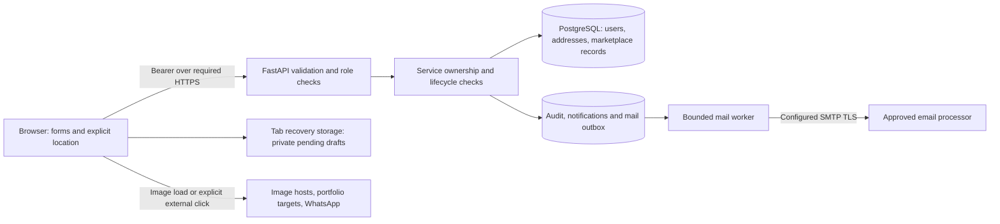

# Personal-data flow

Date: 14 November 2026. Current source at baseline `5da76c8`; synthetic tests only.
This is an engineering inventory, not a legal-compliance opinion.

HTTPS and processor approval in this diagram are required deployment controls,
not verified live connections. No third-party map/geocoder or payment gateway exists.

| Data / subjects | Collection and validation | Storage / processing | Access / external sharing | Deletion / retention |
| --- | --- | --- | --- | --- |
| Buyer/seller/admin name, email, phone, password, role | Auth forms; Pydantic bounded inputs, email normalization, BUYER/SELLER registration only | users; Argon2id RFC_9106_LOW_MEMORY hash; legacy bcrypt upgraded on login | Own identity projection excludes password/phone; admin account list includes phone; delivery phone through scoped fulfillment; SMTP recipient email | No account erase/export/correction endpoint; inactive is not erased |
| Seller shop, phone, dispatch coordinates, confirmation/verification | Own seller forms; bounded schema and explicit coordinate confirmation | seller_profiles; geographic eligibility | Owner; discovery omits phone/exact point/numeric distance, includes shop/verification; authorized operators | Editable; no delete/purge policy |
| Buyer delivery lines, label, city/state/PIN, coordinates/default | Address form and explicit location action; owner identity comes from bearer | addresses; order FK retains historical used fields | Owner; owning seller only during allowed fulfillment states; admin reasoned/audited investigation | Used delivery fields immutable; replace address; no erasure/purge |
| Transient discovery point | Browser geolocation permission/manual input and confirmation; request body | React memory and calculation; saved only through explicit profile/address action | Geographic backend evaluation; browser/OS location provider | Reload/unmount clears memory; no application query-history store found |
| Products/prices/images/stock | Seller schema; positive bounded price/stock; HTTP(S) URLs without credentials | products/product_images; admin moderation | Owned seller/admin; buyer discovery eligibility; browser image host receives IP/network metadata with no-referrer | Edit/deactivate/takedown; no timed purge |
| Order/item snapshots, totals, address/product refs, request UUID, deadlines/disputes | Buyer checkout; ownership, delivery radius, price consent, server totals and stock locks | orders/order_items/audit; durable idempotency and transitions | Owning buyer/seller; admin; ordinary order projections omit delivery address/phone | Retained; terminal state restricts seller fulfillment; no retention schedule |
| Property seller display name, owner/agent capacity, opt-in phone sharing, sale listing/locality/private address | Seller profile/listing forms; sale-only category, bounded text/money | property_profiles/property_listings; moderation/expiry | Approved active public listing omits private address; creator/admin with reason; buyer only confirmed future visit for exact address; opted-in phone in eligible requests | Expiry hides public listing; sold/takedown closes/cancels requests; no purge |
| Property enquiry/reply, appointment/date/status, saves/reports | Buyer request and participant actions; role, ownership, timezone/future checks | property_enquiries/property_visits/saved_properties/property_reports | Participants; admin reports; audited private address reads | Unsave removes save; cancel/reject limits access; messages/reports retained |
| Creative provider profile/bio/portfolio/service listing | Seller forms; bounded fields, HttpUrl links without URL credentials | creative_providers/creative_listings | Owner/admin; approved available listings public; portfolio opens on explicit click | Edit/deactivate/moderation; no delete |
| Creative private brief, quote terms/amounts, accepted snapshot, delivery/completion/review | Buyer enquiry, provider quote, buyer accept/complete; participant authorization | RFQs/responses/engagements/reviews and sessionStorage drafts | Buyer/provider participants; admin service read paths; generic notifications omit private brief | Draft clears on success/explicit clear/tab close, survives logout; DB no purge |
| Notification/outbox recipient/event/entity/body/state | Internal transaction publication; unique event/recipient keys | notifications/email_outbox; worker retry/lease | Recipient-only API; admin aggregates; configured SMTP receives recipient/title/generic body | Read != deletion; disabled mail still accumulates; no TTL |
| Audit actor/entity/reason/state/timestamp | Internal transitions, moderation, private reads, admin investigations | audit_events; bounded operator reasons can contain personal information | Admin/trusted DB operators | No purge/retention/legal-hold procedure |
| Source/email/account abuse scope | Authentication/action limiting; SHA-256 scope | request_quotas counters/windows | Backend/trusted operators; unsalted hash is pseudonymous and guessable for known emails | No cleanup routine; growth documented |
| Token, cart and retry information | Login/session/cart; browser input | JWT/cart/location in memory; scoped order/Creative retries in tab sessionStorage | Same-origin script/browser operator; no auth cookie/localStorage | JWT cleared on logout/expiry; retry drafts retained; SEC-006 |
| Request/browser metadata | HTTP transport/access logs | Application logs use event/error class; Uvicorn/proxy paths and query strings may be logged | Operators/hosting; arbitrary image hosts and user-opened WhatsApp/portfolio destinations | Host/proxy retention/processors unverified |

## Verified safeguards and limitations

- Password plaintext enters only registration/login validation and hashing/verification;
  user storage is password_hash. Repr masking and request-validation errors omit input.
- JWT has only sub/iat/exp; credentials are omitted from browser fetch cookies and
  browser storage. No logout revocation, refresh or password reset endpoint exists.
- API no-store is present. Role/activity/admission reload from the DB; account
  suspension affects existing tokens. Admin privileges are not derived from JWT role.
- Order fulfillment checks actor and lifecycle; property exact address requires
  explicit eligible access; Creative private records are participant-scoped.
- Controlled input values use SQLAlchemy bound expressions. No raw user-built SQL,
  unsafe deserialization, shell execution or backend image fetch found in app code.
- React renders text normally, HTTP(S) portfolio/image URLs are validated, and
  external links use noreferrer. No dangerous HTML rendering sink found in reviewed source.
- No integrated payments or uploads; no payment credentials or uploaded proof data
  should be collected. COD/UPI launch plans require a new approved data-flow review.

Evidence: core/security.py, api/dependencies.py, api/errors.py, all route/schema/model
groups, services/mappers.py, orders.py:208, properties.py:79/148/156/179,
creative.py:194/203/209, notifications.py, mail.py, AuthContext and recovery hooks.
Tests: test_authorization, test_beta_privacy, test_beta_notifications,
test_delivery_confirmation, test_properties and test_creative.

## Required owner/operator decisions

**NEEDS MANUAL REVIEW:** approved processors/regions/subprocessors, privacy contact,
retention/deletion and backup lifecycle, legal holds, data-request identity checks,
admin access reviews and record of actual email/phone verification. Restrict pilot
data to what is necessary; include no genuine customer data in further testing.
Account suspension, listing hiding and reading notifications do not satisfy erasure.
Do not add a purge job or delete rows until retention/schema impact is approved.
